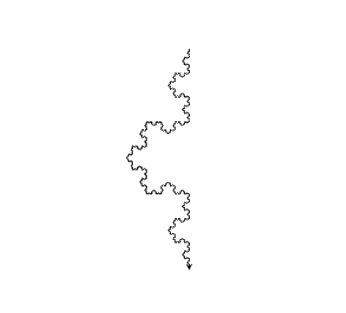

# Interpreter języka inspirowanego Logo

**Autor:** Maciej Kowalski (300239)
**Kurs:** TKOM

## Opis projektu

Celem projektu jest implementacja interpretera języka wzorowanego na Logo. Interpreter realizuje podstawowe funkcje Logo, rozszerzone o instrukcje warunkowe, pętle, wyrażenia algebraiczne oraz funkcje. Wynik wykonania instrukcji jest przedstawiany graficznie.

## Funkcjonalności

* Odczyt, parsowanie i analizowanie pliku wejściowego
* Zgłaszanie błędów wraz z informacją o miejscu ich wystąpienia
* Interpretacja kodu
* Dynamiczne typowanie zmiennych
* Definiowanie funkcji
* Wbudowane funkcje do obsługi markera (żółwia)
* Wykonywanie obliczeń z zachowaniem priorytetów operatorów
* Instrukcje warunkowe `if` i pętle `while`
* Przysłanianie zmiennych
* Wypisywanie komunikatów na standardowe wyjście (`print`)
* Wbudowane typy: `number`, `string`, `bool`

## Użycie

### Uruchomienie interpretera

```bash
python3 main.py [file]
```

### Uruchomienie testów

```bash
pytest testfile.py
```

## Składnia

* **Definiowanie zmiennych:**

  ```
  number = 0
  bool = True
  string = "Ala ma kota"
  ```
* **Definicja funkcji:**

  ```
  def function_name(param1, param2) {
      return(param1);
  }
  ```
* **Instrukcja warunkowa:**

  ```
  if(condition) {
      return(condition);
  } else {
      return(!condition);
  }
  ```
* **Pętla:**

  ```
  while(condition) {
      return(condition);
  }
  ```
* **Operatory arytmetyczne i logiczne:**

  * Dodawanie: `+`
  * Odejmowanie: `-`
  * Mnożenie: `*`
  * Dzielenie: `/`
  * I logiczne: `&&`
  * Lub logiczne: `||`
  * Porównania: `==`, `!=`, `<`, `>`, `<=`, `>=`

Każde wyrażenie musi być zakończone średnikiem.

### Przykładowy program

```python
def snowflake(lengthSide, levels) {
    if(levels == 0) {
        forward(lengthSide);
        return();
    }
    lengthSide = lengthSide / 3.0;
    snowflake(lengthSide, levels-1);
    left(60);
    snowflake(lengthSide, levels-1);
    right(120);
    snowflake(lengthSide, levels-1);
    left(60);
    snowflake(lengthSide, levels-1);
}
snowflake(400,5);
```

Wynik działania:



## Gramatyka

```
program = { statement | definition };
definition = "def" identifier, parameters, block;
parameters = "(", [ identifier, { ",", identifier } ], ")";
statement = if_statement | while_statement | function | assignment;
if_statement = "if", "(", logic_expression, ")", block, [ "else", block ];
while_statement = "while", "(", logic_expression, ")", block;
block = "{", { statement }, "}";
assignment = identifier, "=", logic_expression;
logic_expression = condition, { "||", condition };
condition = relation, { "&&", relation };
relation = math_expression, [ comp_sign, math_expression ];
math_expression = factor, { add_sign, factor };
factor = logic_factor, { mult_sign, logic_factor };
logic_factor = value | "(" logic_expression ")";
value = [ "!" | add_sign ], ( identifier | function | number | string );
function = identifier, function_arguments;
function_arguments = "(" [ logic_expression, { ",", logic_expression } ], ")";
add_sign = "+" | "-";
mult_sign = "*" | "/";
logic_sign = "||" | "&&";
comp_sign = "==" | "!=" | "<" | "<=" | ">" | ">=";
identifier = letter, {natural_number | letter | special_sign};
string = '"' {letter | natural_number | special_sign | string_escape_sign} '"';
number = natural_number [ ".", digit, {digit}];
natural_number = "0" | (non_zero_digit, {digit});
letter = "A" | ... | "z";
digit = "0" | non_zero_digit;
non_zero_digit = "1" | ... | "9";
special_sign = "_";
string_escape_sign = '//';
```

## Tokeny

* `Identifier` – identyfikatory zmiennych i funkcji
* `Number` – stałe liczbowe

## Słowa kluczowe

`if`, `while`, `else`, `def`, `return`, `print`, `true`, `false`

## Operatory

`+`, `-`, `*`, `/`, `=`, `<`, `>`, `<=`, `>=`, `||`, `&&`, `==`, `!=`

## Znaki gramatyczne

`;`, `"`, `(`, `)`, `{`, `}`

## Testy

Testy interpretera znajdują się w katalogu `test` i obejmują trzy moduły:

* `Parser_tests.py` – sprawdza parser
* `Lexer_tests.py` – sprawdza lekser
* `Interpreter_tests.py` – sprawdza interpreter

Testy były pisane równolegle z implementacją i pomagają weryfikować poprawność działania kodu.
